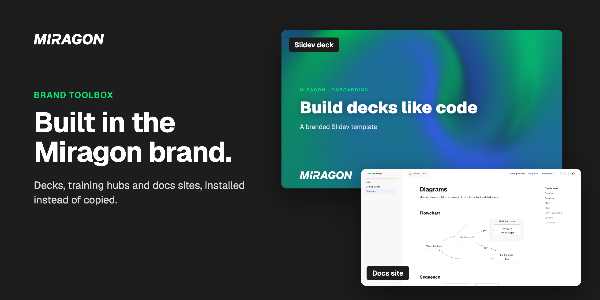

# Miragon brand toolbox

[](https://github.com/Miragon/brand-toolbox/actions/workflows/ci.yml)
[](LICENSE)



Ready-made building blocks for what you deliver in the Miragon brand: talk, workshop and sales decks, training sites with a sign-in, and docs sites for Miragon tools.

## Why

Decks, trainings and docs sites used to start as a copy of an older repo, and every copy drifted: old colours, old fonts, fixes that never arrived. Here each building block is an npm package, so a fix is made once and reaches your repo as a version update.

## What you get

- **On brand from the first commit.** Colours, fonts, logos and layouts come from the Miragon corporate design; you write the content.
- **Brand checks for decks.** Every deck comes with a linter that flags off-brand slides before you present them.
- **Claude Code knows the deck rules.** The `miragon-slidev` plugin teaches Claude Code the deck layouts and the brand rules.

## The building blocks

Each kit's page walks you through the rest. The kits use npm, on macOS or Linux.

| You deliver | Kit | Start with |
| --- | --- | --- |
| A talk, workshop or sales deck | [Slidev](kits/slidev/) (slides in Markdown) | `npm create @miragon/slidev-deck@latest my-talk` |
| A training with one password-protected site for participants | [Training hub](kits/hub/) (a deck plus a sign-in site around it) | `npm create @miragon/slidev-deck@latest my-training -- --hub` |
| The docs site of a Miragon tool | [Docs](kits/docs/) (a VitePress theme) | [Four steps](kits/docs/#get-started) in your repo's `docs/` folder |

## With your AI assistant

A new deck or hub offers the `miragon-slidev` Claude Code plugin once you trust its folder in Claude Code. To have it in every project, add the marketplace and install the plugin of the same name:

```text
/plugin marketplace add Miragon/brand-toolbox
/plugin install miragon-slidev@miragon-slidev
```

## Help and feedback

- **Bugs and ideas:** [open an issue](https://github.com/Miragon/brand-toolbox/issues).
- **Brand questions** (colours, logo, wording): the [corporate identity guide](https://github.com/Miragon/corporate-identity), for Miragon staff.

## Contributing

How the kits are built, tested and released is in [CONTRIBUTING.md](CONTRIBUTING.md). Pull requests from outside the Miragon team are not accepted; please open an issue instead.

## License

[MIT](LICENSE) © Miragon GmbH. The Miragon name and logo are trademarks of Miragon GmbH.
