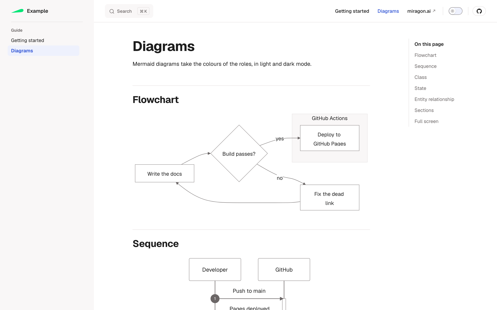

# Miragon docs kit

Give your Miragon tool's VitePress docs the Miragon look on GitHub Pages with one call to `miragonDocs()`.

## Why

Each Miragon docs site used to carry its own copy of the kit, and the copies drifted apart. With `@miragon/docs-starter` your repo pins a version instead, and a fix is one update away.

## What you get

- **The Miragon look, light and dark.** Geist, the brand colours, the comet in the title and the legal row with imprint and privacy on every page.
- **Anchors like on GitHub.** Headings get the ids GitHub gives them, so a `#link` works in the repo and on the site.
- **Mermaid in the brand colours.** Diagrams take the brand greys and open full screen on click.
- **The usual docs features set up.** Local search, an "Edit this page on GitHub" link and a star button for your repo.

## Get started

You need npm and Node.js 22.12 or newer on macOS or Linux. In your repo's `docs/` folder:

1. Take [`example/package.json`](example/package.json) as your `docs/package.json`, change its name and keep its `overrides`.
2. In `docs/`, run `npm install --save-dev --save-exact @miragon/docs-starter`.
3. Copy [`templates/config.ts`](templates/config.ts) to `docs/.vitepress/config.ts` and [`templates/theme-index.ts`](templates/theme-index.ts) to `docs/.vitepress/theme/index.ts`. Fill in your repo, title and navigation, and create the pages the navigation links to.
4. Run `npx vitepress dev` and open the address it prints.

To publish on GitHub Pages, copy [`templates/docs.yml`](templates/docs.yml) to `.github/workflows/docs.yml` and set the Pages source of your repo to **GitHub Actions**. Optional: a landing page with a demo in [`templates/landing/`](templates/landing/). Every option of `miragonDocs()` is in the [package README](packages/docs-starter/README.md#options).

To take a new version: `npm install --save-dev --save-exact @miragon/docs-starter@latest` in `docs/`. Docs inside an npm workspace keep the `overrides` in the root `package.json` instead.

Your docs already have a copy of the kit in `docs/.vitepress/miragon/`? [MIGRATION.md](MIGRATION.md) moves them to the package.

## Help and feedback

- **Bugs and ideas:** [open an issue](https://github.com/Miragon/brand-toolbox/issues).

## Contributing

To build or change the kit, see [CONTRIBUTING.md](../../CONTRIBUTING.md).

## License

[MIT](../../LICENSE) © Miragon GmbH. The Miragon name, logo and comet are trademarks of Miragon GmbH and not covered by the licence.
