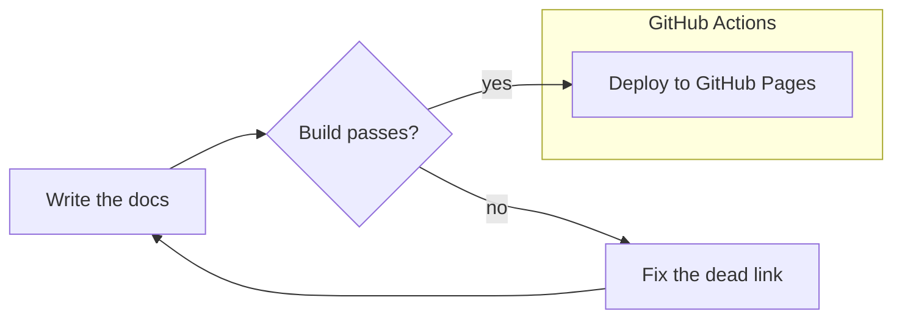
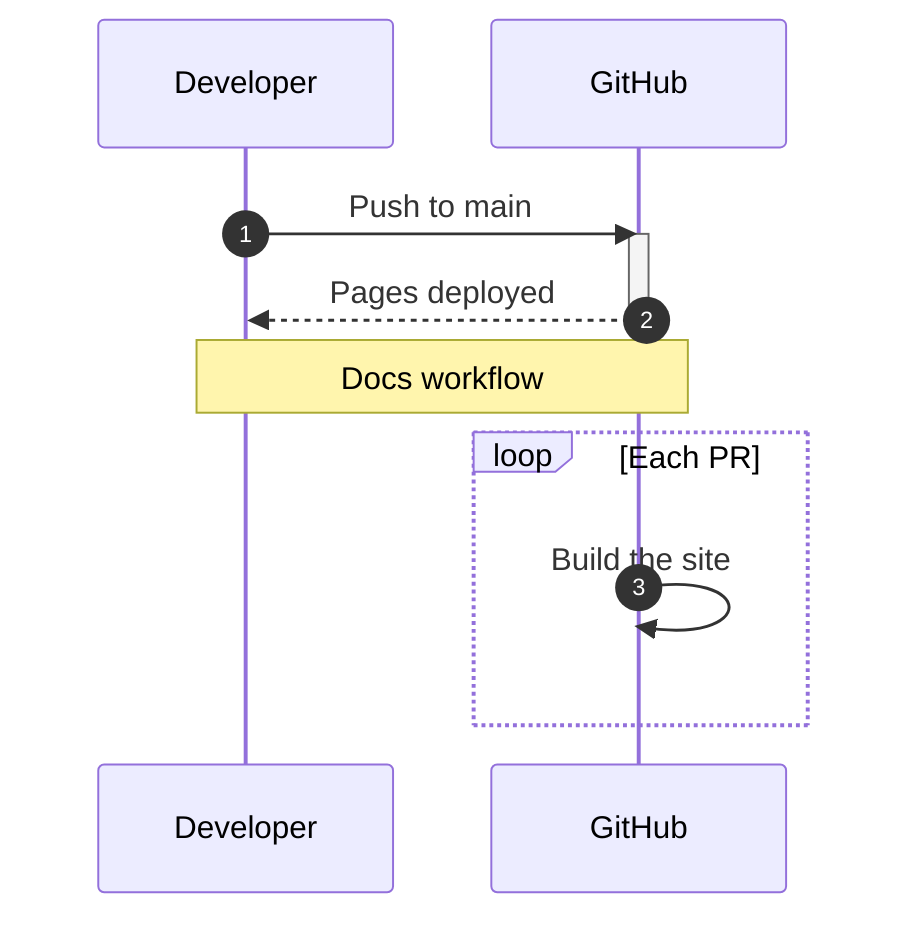
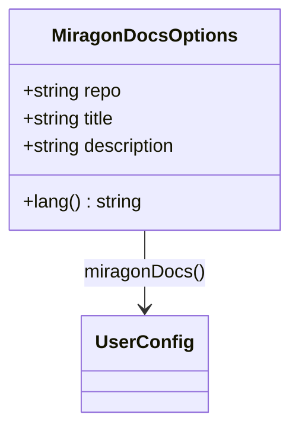
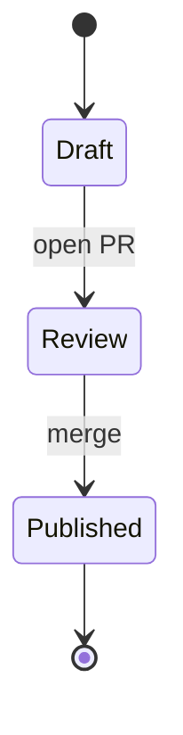
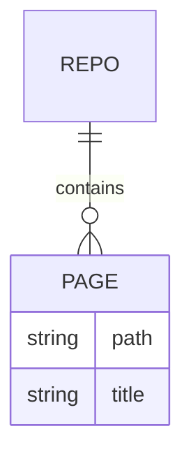
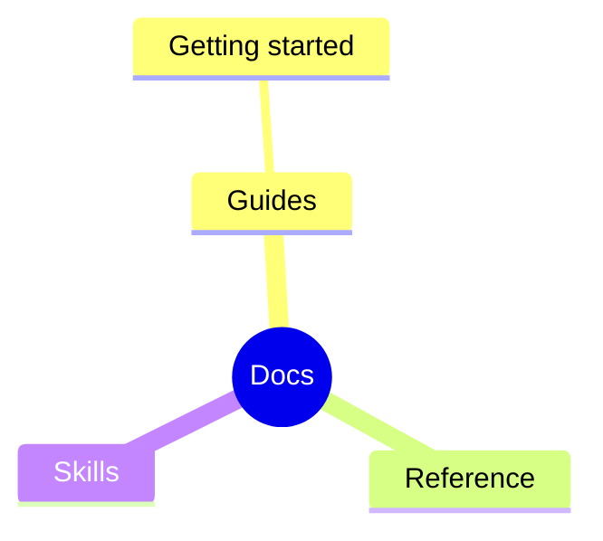
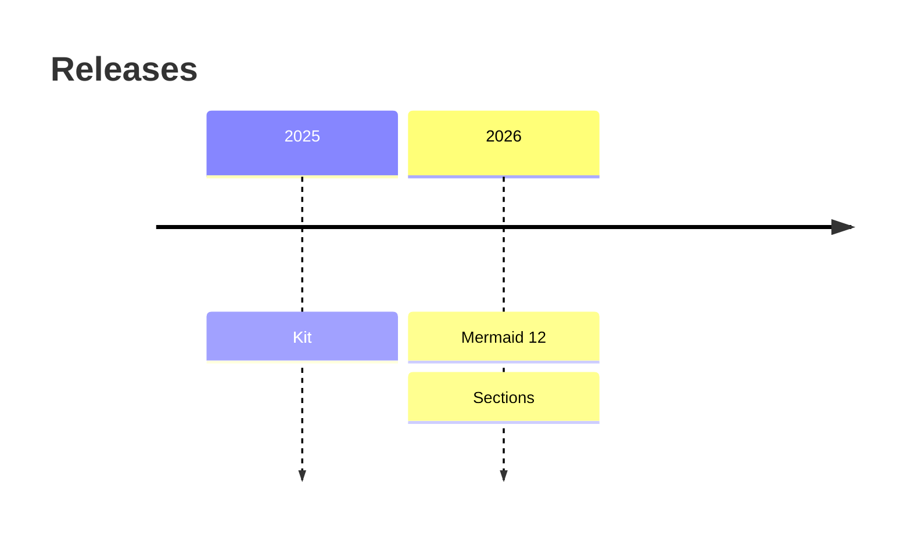
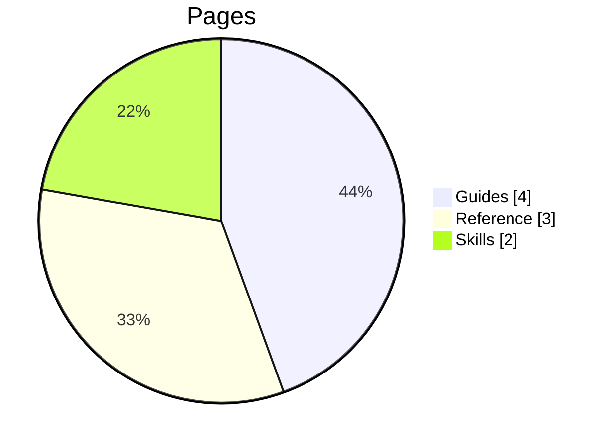
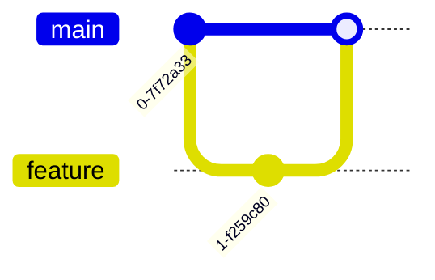

# Diagrams

Mermaid diagrams take the colours of the roles, in light and dark mode.

## Flowchart

## Sequence

## Class

## State

## Entity relationship

## Sections

Diagrams with sections take two CI greys in turn, each with a label colour that holds 4.5:1 on it.

## Full screen

Click an image or a diagram to open it full screen; Esc closes it. Anything else opens the same
way when it is wrapped in `data-zoom`:

  <svg viewBox="0 0 120 40" width="240"><rect x="1" y="1" width="118" height="38" rx="6" fill="none" stroke="currentColor"/><text x="60" y="25" text-anchor="middle" font-size="12" fill="currentColor">data-zoom</text></svg>

