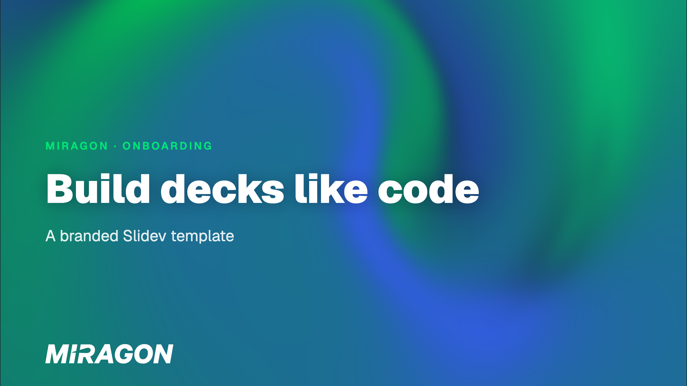

# Miragon Slidev kit

[](https://www.npmjs.com/package/@miragon/create-slidev-deck)
[](https://www.npmjs.com/package/@miragon/slidev-toolkit)
[](https://github.com/Miragon/brand-toolbox/actions/workflows/ci.yml)
[](../../LICENSE)



Write your talk, workshop or training deck in Markdown and present it in the Miragon brand.

## Why

A deck copied from last year's talk carries last year's colours, fonts and mistakes. Here the design is a package your deck depends on: you write slides, and brand fixes arrive as version updates.

## What you get

- **17 layouts for every kind of slide.** BPMN with token simulation, DMN tables, diagrams, quizzes and more; the [layout list](packages/toolkit/README.md#layouts) shows all of them.
- **Brand checks before you present.** `npm run verify` checks every slide against the design rules, and your deck's CI runs the quick checks on every push.
- **One deck, several speakers.** With speaker profiles, each speaker keeps their own selection of slides without copying the deck.
- **Claude Code knows the deck.** The `miragon-slidev` plugin teaches Claude Code the layouts, components and brand rules.

## Get started

You need npm and Node.js 24 or newer on macOS or Linux (22.22 is enough for everything but `npm run dev`).

```bash
npm create @miragon/slidev-deck@latest my-talk
cd my-talk
npm install
npm run dev
```

Your deck opens at `https://my-talk.localhost`. The first run asks once for your computer's admin password to set up a local HTTPS proxy; without admin rights, use `npm run dev:app` instead.

Replace the demo slides under `deck/chapter/`: each one says what its layout is for, and the cover and closing are in `deck/slides.md`. Commit `package-lock.json` so CI can install. The `README.md` in your new deck lists every command. The reference deck is live at [slidev-template.netlify.app](https://slidev-template.netlify.app).

To take a new version of the theme and the checks: `npm install --save-exact @miragon/slidev-toolkit@latest @miragon/slidev-validator@latest`.

Running a training? `npm create @miragon/slidev-deck@latest my-training -- --hub` adds a sign-in site around the deck; see the [training hub](../hub/).

## With your AI assistant

Your new deck offers the `miragon-slidev` plugin once you trust its folder in Claude Code. It brings the `slides`, `excalidraw` (diagrams) and `create-training-hub` (training site) skills. To have it in every project:

```text
/plugin marketplace add Miragon/brand-toolbox
/plugin install miragon-slidev@miragon-slidev
```

## Help and feedback

- **Something does not work:** see [Troubleshooting](deck/README.md#troubleshooting).
- **Bugs and ideas:** [open an issue](https://github.com/Miragon/brand-toolbox/issues).

## Contributing

To build or change the kit, see [CONTRIBUTING.md](../../CONTRIBUTING.md).

## License

[MIT](../../LICENSE) © Miragon GmbH. Your own deck carries no licence, so your slides stay yours.
